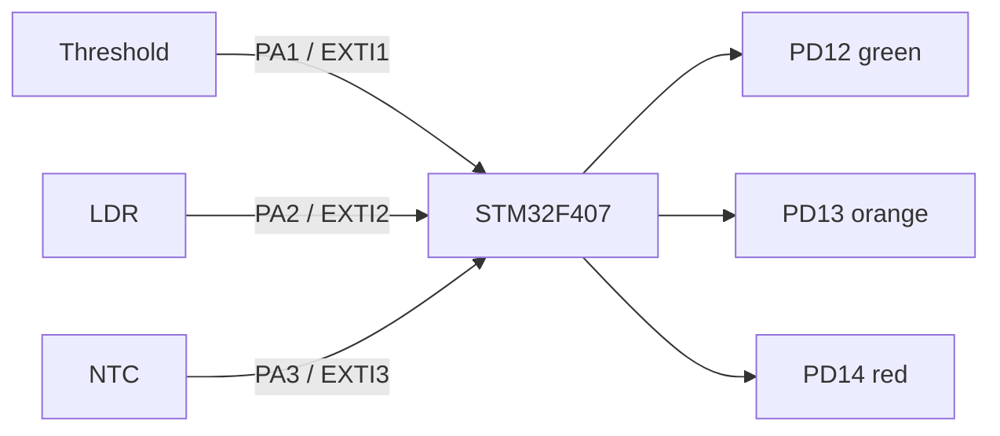

# EXTI Multi-Sensor Interrupts


-orange)


Three digital sensor modules — a **threshold (comparator) module**, an **LDR module** and an **NTC module** — each on its own **external interrupt line**, on an STM32F407 Discovery board. Written at register level (CMSIS only, no HAL). There is no polling: the main loop is empty and every response happens in an interrupt handler, which toggles an LED (or a relay driver) for that sensor.

## Features

- **Three independent EXTI lines** (EXTI1–3 on PA1–PA3), each with its own interrupt vector
- **Rising-edge trigger** with internal pull-ups on the inputs
- **Signal check in the ISR**: the pin level is re-read before acting, filtering out short glitches that have already ended
- **NVIC** configured with `NVIC_SetPriority` / `NVIC_EnableIRQ` (all three at the same priority)

## Hardware

| Part | Notes |
|---|---|
| STM32F407G-DISC1 | Default 16 MHz HSI clock; on-board LEDs used |
| Threshold module | Digital output (e.g. comparator board) |
| LDR module | Digital output |
| NTC module | Digital output |

### Wiring

| Sensor | Input pin | EXTI line | Output |
|---|---|---|---|
| Threshold | PA1 | EXTI1 | PD12 (green LED) |
| LDR | PA2 | EXTI2 | PD13 (orange LED) |
| NTC | PA3 | EXTI3 | PD14 (red LED) |

Connect the module grounds to the board GND. PD12–PD14 can also drive relay modules instead of the on-board LEDs.



## Build and flash

Requires the [Arm GNU Toolchain](https://developer.arm.com/downloads/-/arm-gnu-toolchain-downloads) (`arm-none-eabi-gcc`) and GNU Make.

```bash
make            # -> build/EXTI_MultiSensor.elf / .bin
make flash      # uses st-flash (stlink tools)
```

## Known limitations

- Each rising edge toggles the output, so the LED shows the parity of events rather than the sensor's current state.
- No debounce beyond the pin re-check; noisy module outputs can toggle more than once.

---

### 🇹🇷 Türkçe özet

STM32F407 Discovery üzerinde, HAL kullanmadan register düzeyinde yazılmış çoklu harici kesme örneği. Eşik, LDR ve NTC modüllerinin dijital çıkışları PA1–PA3'e bağlı; her biri kendi EXTI hattında yükselen kenarda kesme üretiyor. Ana döngü boş; her kesme pini tekrar okuyup doğruladıktan sonra ilgili LED'i (PD12/PD13/PD14) değiştiriyor.
